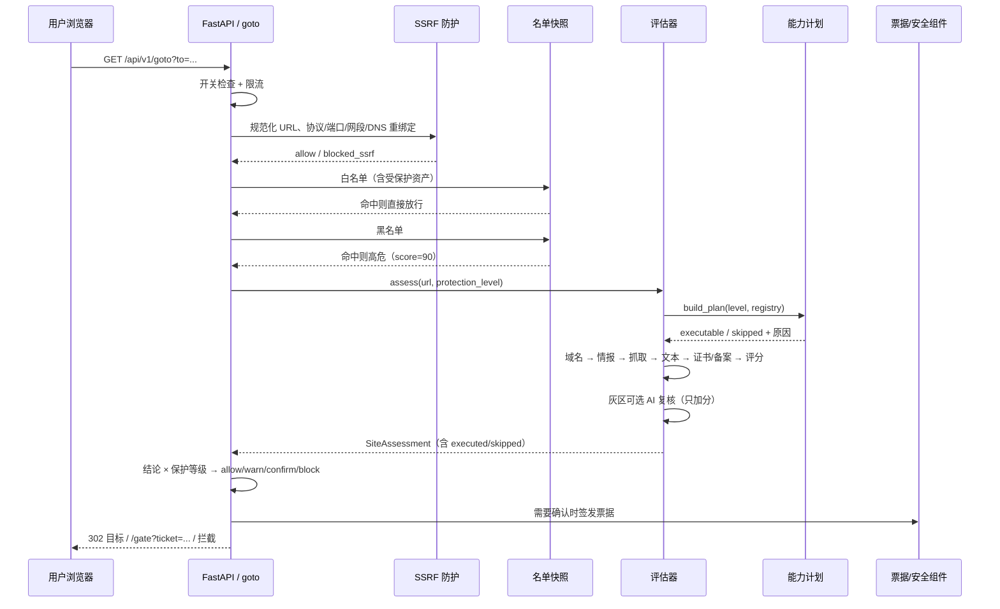
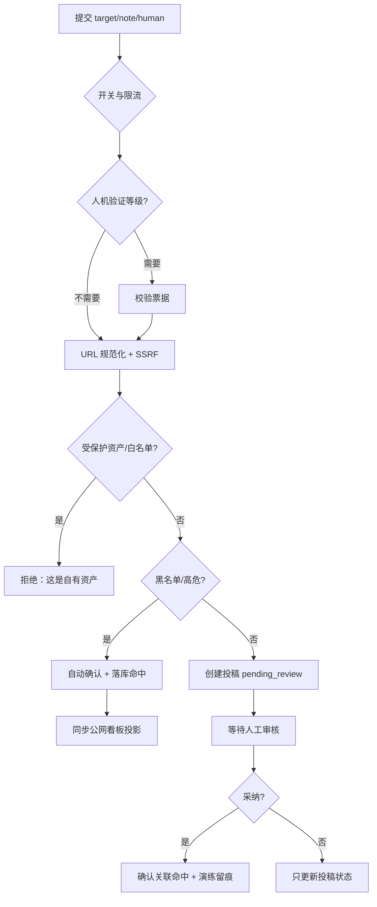
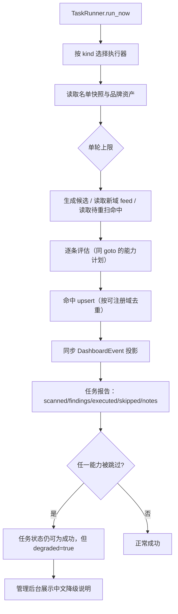
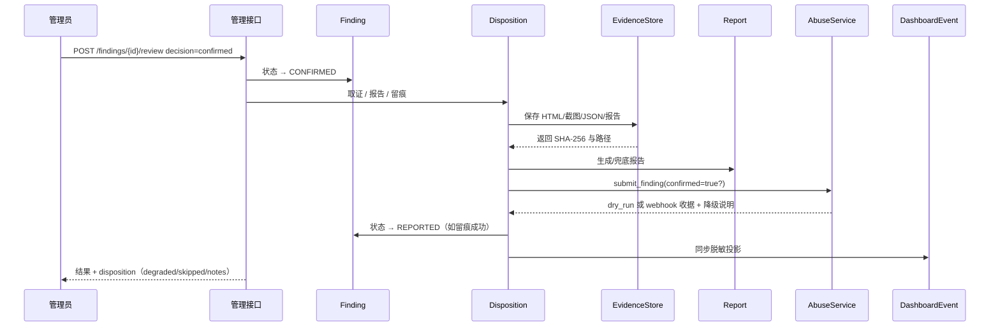
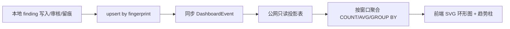
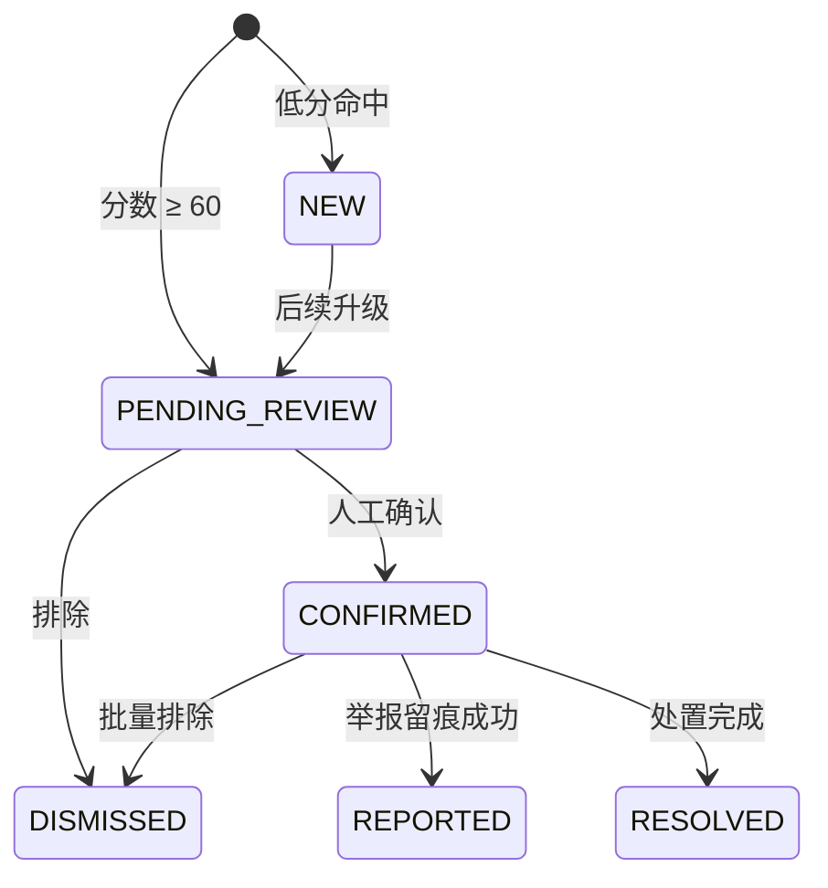

# 全流程：看得见的与看不见的

> 这篇文档把「用户点一下链接 / 后台跑一轮扫描 / 收到一条举报」与
> 「系统内部发生了什么」拆开画出来。三条入口最终汇入同一条判定、取证与处置链；
> 看得见的流程帮助演示与验收，看不见的流程帮助排查与改动。

## 一、启动：从双击到可用

**看得见**：双击 `launch.bat`（或 `./launch.sh`）→ 终端打印模式/端口/公网地址 → 浏览器打开 → 看板出现数据。

**看不见**：

```mermaid
flowchart TD
    A[launch.bat / launch.sh] --> B{server/.venv 可用?}
    B -- 否 --> C[Windows：删除跨系统/损坏 venv 并重建<br/>Linux：改用 server/.venv-linux]
    B -- 是 --> D[复用环境]
    C --> E[pip install -e .[dev]]
    D --> F{server/.env 存在?}
    E --> F
    F -- 否 --> G[复制 .env.example]
    F -- 是 --> H[保留主密钥不动]
    G --> I[按需构建前端<br/>源码时间戳 > 产物时间戳]
    H --> I
    I --> J[导出 TRUESIGHT_MODE/HOST/PORT/PUBLIC_BASE_URL]
    J --> K[uvicorn app.main:create_app --factory]
    K --> L[lifespan: 建表]
    L --> M[回填公网看板投影]
    M --> N[应用库内设置覆盖]
    N --> O[重新装配模型供应商]
    O --> P{调度开关开启?}
    P -- 是 --> Q[启动 APScheduler]
    P -- 否 --> R[只提供 API 与页面]
```

关键点：

* 根配置 `truesight.config.json` 只提供**默认值**，优先级为
  命令行 > 环境变量 > 根配置 > 内置默认；
* `.env` 中显式写过的公网地址不会被根配置覆盖；
* venv 跨系统污染会被自动识别并重建（见 [FAQ 第十三节](FAQ.md#十三windows-和-wsl-交替运行为什么报-no-python-at-usrbinpython-exe)）。

## 二、出站判定 `/api/v1/goto`（核心链路）

### 2.1 看得见

用户点击外链 → 命中「放行 / 风险中间页 / 拦截页」之一。
风险中间页展示目标域名、风险等级、理由与继续按钮；拦截页不提供继续。

### 2.2 看不见



### 2.3 结论映射

按**风险等级**而不是只看结论字符串：

| 风险等级 \ 保护等级 | 1 | 2（默认） | 3 | 4 | 5 |
| --- | --- | --- | --- | --- | --- |
| 中等 | 放行 | 明细 + 确认 1 次 | 明细 + 确认 2 次 | 明细 + 确认 3 次 | 直接拦截 |
| 高 / 极高 | 提示可继续 | 明细 + 确认 1 次 | 明细 + 确认 2 次 | 明细 + 确认 3 次 | 直接拦截 |
| 低 / 未知 | 放行 | 放行 | 放行 | 放行 | 放行 |
| 无法判定 | 提示可继续 | 明细 + 确认 | 直接拦截 | 直接拦截 | 直接拦截 |

「拦截提示」页展示风险等级、分数与判定依据（来自签名票据，不重新评估）；
3 / 4 级需要多次点击确认，5 级不提供继续按钮。

「无法判定」不是异常：目标不可达、超时、能力缺失都会得到
`INDETERMINATE`，并按等级降级；评估结果里带 `executed` 与 `skipped` 列表。

## 三、人工举报 `/api/v1/report`

### 3.1 看得见

用户在「提交举报」页填写网址与说明 → 提交 → 看到「已受理 / 转入人工审核 / 已拒绝」结果页。

### 3.2 看不见



举报者 IP **不入库**：服务端只用「IP + UA + 路径」派生带盐哈希作为限流键。

## 四、周期任务 / 立即执行

### 4.1 看得见

管理员在「服务」页选择任务类型 → 点击「立即执行一次任务」→ 看到任务状态、执行/跳过步骤、
本轮命中列表；命中可展开、打开网址、确认仿冒或排除。刷新页面结果仍在（`localStorage`）。

### 4.2 看不见



五类任务：

| kind | 作用 | 主要边界 |
| --- | --- | --- |
| `typosquat_scan` | 对受保护资产生成形近候选并评估 | `max_probe_per_scan`、`max_findings_per_run` |
| `new_domain_watch` | 从 `DomainFeed` 读取新注册域名并筛查 | 默认只有演示 feed |
| `content_check` | 重扫历史命中 | `max_assessments_per_run` |
| `forensics` | 为命中补齐证据 | 需要命中可访问 |
| `abuse_report` | 为已确认命中生成举报留痕 | 默认 `dry_run` |

## 五、确认、处置与证据

### 5.1 看得见

日志页命中详情 → 「确认仿冒」→ 条目移入「确认仿冒」视图 → 生成演练留痕；
「处置」→ 取证与研判报告；证据表显示类型、路径、大小、SHA-256 前缀。

### 5.2 看不见



证据固定：

```text
文件名 = <kind>-<UTC 时间戳>-<SHA256 前 8 位>.<扩展名>
校验   = 重新计算文件 SHA-256 与索引比对
清单   = truesight.evidence.manifest/1（含每个文件的哈希与元数据）
```

## 六、公网态势看板

### 6.1 看得见

公网「仿冒态势」：近 N 天识别总数、平均分、高风险占比、趋势、风险/意图分布、地区分布。
7/30/90 天切换，60 秒自动刷新。

### 6.2 看不见



投影字段只有：脱敏域名、可注册域、意图、风险、分数、状态、时间、地区。
**没有**原始 URL、证据正文、注册人、精确 IP。

## 七、失败与降级路径（看不见但必须懂）

| 场景 | 系统行为 | 用户能看到什么 |
| --- | --- | --- |
| 目标 DNS 解析失败 | SSRF fail-closed | `blocked_ssrf` 或 `indeterminate` + 说明 |
| robots 禁止抓取 | 不抓取，跳过文本层 | `skipped_capabilities` 含 `crawler` |
| TLS 握手失败 | 证书层记失败，不冒充「无证书」 | 中文降级说明 |
| 未配置 AI | 规则评分继续 | 「未配置大模型研判」 |
| 模型超时/JSON 非法 | 保持规则分 | 降级说明，不阻塞结论 |
| 情报/ICP/新域源缺失 | 能力标记 skipped | 明确列出缺哪一层 |
| 前端产物缺失 | 后端 API 照常 | 页面 404，接口可用 |
| 证据写入失败 | 返回 `storage_error`，任务标失败 | 错误信息 + 审计 |
| 举报留痕失败 | `skipped=["abuse"]`、`degraded=true` | 结果里明确提示 |

## 八、状态机



> 注：当前界面提供「确认仿冒 / 排除」与「排除全部」（确认仿冒视图）；
> 没有「撤销排除」入口。状态转换的最终事实以 `app/services/admin.py` 与 [API](API.md) 为准。
